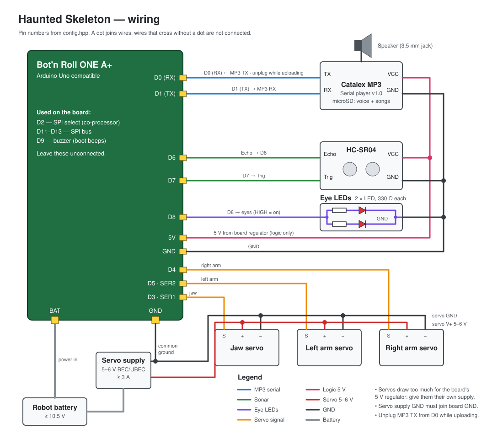
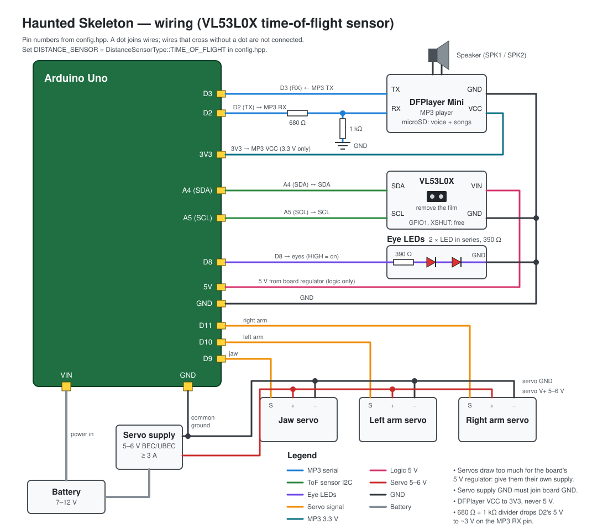

# Haunted Skeleton

Arduino sketch for an animatronic Halloween skeleton built on an
Arduino Uno.

- Plays the songs on the SD card in order on power-up, looping back to
  the first song after the last one.
- When a visitor walks up, the song pauses and one of the voice clips,
  picked at random but never the same twice in a row, plays with the jaw
  synced to it, and each arm goes up and back down, one slightly after
  the other. The song then resumes where it left off.
- The jaw then rests for at least 5 s before it can be triggered again.

## Hardware

| Part | Connection |
|---|---|
| VL53L0X time-of-flight sensor | **VIN on 3V3, not 5V**; GND → GND, SDA → A4, SCL → A5 |
| *or* HC-SR04 sonar | trig pin 7, echo pin 6 |
| DFPlayer Mini | **VCC on 3V3, not 5V**; module TX → pin 3; pin 2 → 680 Ω → module RX, 1 kΩ from module RX to GND; module BUSY → A0 |
| Jaw servo | pin 9 |
| Arm servos | left: pin 10, right: pin 11 |
| Eye LEDs | pin 8 |

All pins, angles, distances and timings live in [`config.hpp`](config.hpp).
Set `DISTANCE_SENSOR` there to the sensor you fitted:
`DistanceSensorType::TIME_OF_FLIGHT` (VL53L0X) or
`DistanceSensorType::SONAR` (HC-SR04). The detection range
(`DETECT_MIN_CM` / `DETECT_MAX_CM`) applies to both.

The VL53L0X runs on 3.3 V and its SDA/SCL pins are not 5 V tolerant. The
sketch turns off the Uno's internal pull-ups (which go to 5 V), so the
sensor board's own pull-ups to 3.3 V must hold the lines high; if the
board has none, fit 4.7 kΩ from SDA and from SCL to 3V3. The bus runs at
100 kHz because 3.3 V only just counts as high for the Uno. Peel off the
protective film over the lens.

The 3V3 pin also feeds the DFPlayer and can only supply about 150 mA
(Uno R3). If the sensor drops out while music plays loudly, power both
from a separate 3.3 V regulator instead.

With the VL53L0X in place of the sonar:

## Setup

1. Install the **Servo**, **DFRobotDFPlayerMini** (1.0.6) and
   **VL53L0X** by Pololu (1.3.1) libraries in the Arduino IDE. The
   VL53L0X library is needed even when the sonar is selected.
2. Format a FAT32 SD card and copy the songs to its root one at a time
   in the order they should play (the module numbers tracks by copy
   order). Then create a folder `ADVERT` and copy the voice clips from
   `sd_card/` into it, renamed so each starts with a **4-digit** number:
   `0001_WhoAreYou.mp3`, `0002_ComeHere.mp3`, ... (the module only reads
   the first four digits). An advert pauses the song and the song resumes
   where it left off. Set `MP3_SONG_COUNT` in `config.hpp` to the number
   of songs.
   After adding, removing or changing a voice clip, regenerate the jaw
   scripts with `python3 tools/make_jaw_script.py` (needs numpy and
   ffmpeg); clip N in `sd_card/` must be advert N on the card.
3. Power the servos well: three servos (two lifting arms) can draw more
   current than the board's 5 V regulator supplies.
4. If the eyes blink 5 times at power-up, the MP3 player or its SD card
   did not answer: check the wiring and the card. `tools/mp3_test` tests
   the player on its own. If they blink 3 times, the VL53L0X did not
   answer: check its I2C wiring. `tools/tof_test` tests the sensor on
   its own.
5. Calibrate `MOUTH_CLOSED_DEG` / `MOUTH_OPEN_DEG` and the arm angles and
   sweep times in `config.hpp` for your build.

## Known issues

- **Servo twitches when a track starts or ends.** SoftwareSerial pauses
  interrupts while each byte to or from the DFPlayer is sent or received,
  and the servos depend on those interrupts. If the twitch is a problem,
  move the DFPlayer to hardware Serial (pins 0/1) and pass `Serial` to
  `Mp3Player` instead of a SoftwareSerial port.

## Code layout

| File | Purpose |
|---|---|
| `skeleton.ino` | Entry point |
| `haunted_skeleton.*` | Behaviour state machine |
| `mp3_player.*` | DFPlayer Mini wrapper |
| `presence_sensor.hpp` | Picks the sensor selected in `config.hpp` |
| `presence_filter.*` | Debounced presence detection shared by both sensors |
| `tof_sensor.*` | VL53L0X time-of-flight sensor |
| `sonar.*` | HC-SR04 ultrasonic sensor |
| `mouth.*` | Scripted jaw animation |
| `arm.*`, `arms.*` | Staggered up-and-down servo arm gesture |
| `eyes.*` | Eye LEDs |
